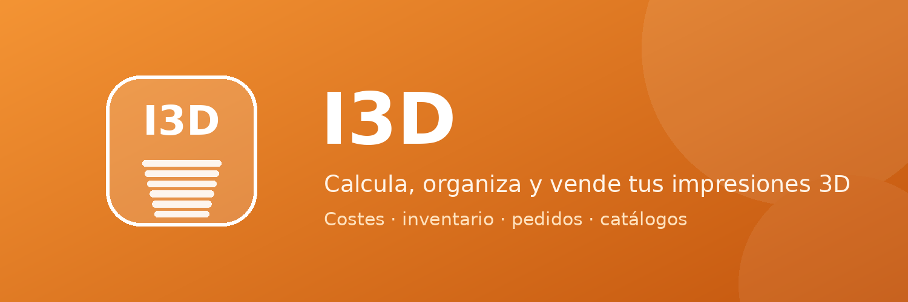

# I3D

App para iPhone y iPad para gestionar un estudio de impresión 3D: calcula
el coste y el precio de cada pieza a partir del archivo del laminador, lleva
el inventario, gestiona clientes, pedidos, cobros y la cola de impresión, y
publica catálogos con hoja de pedido.

**Privacidad:** los datos se guardan solo en tu dispositivo (o en la carpeta
de iCloud Drive que tú elijas para compartirlos). Sin cuentas, sin
servidores, sin publicidad.

## Cómo instalarla (gratis)

I3D no está en el App Store. Se instala con **SideStore**, que es gratuito
y firma la app con tu propio Apple ID (puedes usar uno secundario).

1. Instala SideStore siguiendo su guía oficial (la primera vez necesitas un
   ordenador, solo una vez).
2. En SideStore: pestaña **Fuentes** > **+** > pega esta dirección:

   `https://raw.githubusercontent.com/Atypicapp/I3D/main/fuente.json`

3. Abre la fuente I3D e instala la app.

### Con otras herramientas (AirSign, Sideloadly…)

Si tu herramienta instala desde una dirección, usa esta. Siempre descarga
la última versión:

`https://github.com/Atypicapp/I3D/releases/latest/download/I3D.ipa`

## Actualizaciones

Cuando haya una versión nueva, SideStore la mostrará en **Mis apps**.
Pulsa **Actualizar** (con LocalDevVPN conectado).
**No borres la app para actualizar**: actualizar encima conserva tus datos;
borrarla los borra (salvo que uses una carpeta de iCloud Drive).

Recuerda que con un Apple ID gratuito las apps caducan a los 7 días si
SideStore no las renueva: ábrelo de vez en cuando o activa la renovación
automática.

---

## Para publicar una versión nueva (solo el autor)

1. En Xcode, sube la **Version** (0.5 → 0.6…) y saca el `.ipa`.
2. Aquí en GitHub: **Releases** > **Draft a new release**.
3. **Tag**: `v` + la versión, por ejemplo `v0.5.0` (Create new tag).
4. Título libre y, en la descripción, las novedades (salen en SideStore).
5. Arrastra el archivo, llamado `I3D.ipa`, y pulsa **Publish release**.

En un minuto `fuente.json` se actualiza solo (pestaña **Actions**) y
SideStore avisará a todos.

## Capturas e imágenes de SideStore (solo el autor)

- **Capturas**: súbelas a la carpeta [`capturas`](capturas) (Add file ›
  Upload files). Se ordenan por nombre (`1-inicio.png`, `2-calcular.png`…)
  y aparecen solas en SideStore. Para quitar una, bórrala.
- **Cabecera** de la fuente: `imagenes/cabecera.png` (1500×500).
- **Noticias**: la imagen de cada noticia es `imagenes/<identificador>.png`
  (por ejemplo `imagenes/catalogos.png`).

Al subir o cambiar algo en esas carpetas, `fuente.json` se actualiza solo
(pestaña **Actions**). Las novedades de cada Release se limpian de símbolos
de Markdown (#, **…) porque SideStore los mostraría tal cual.
