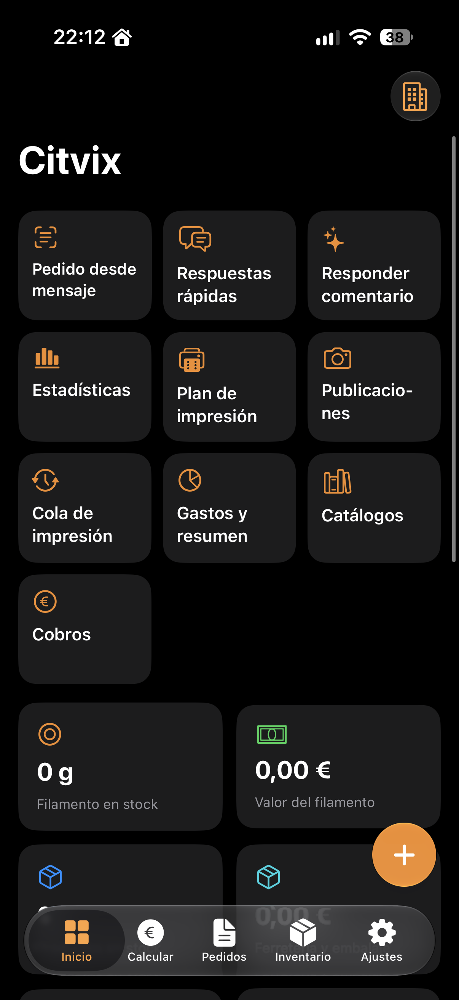
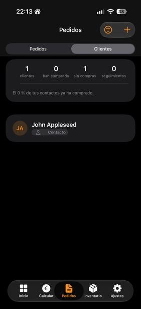
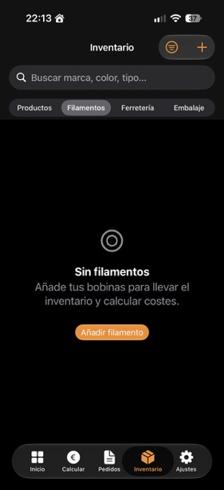
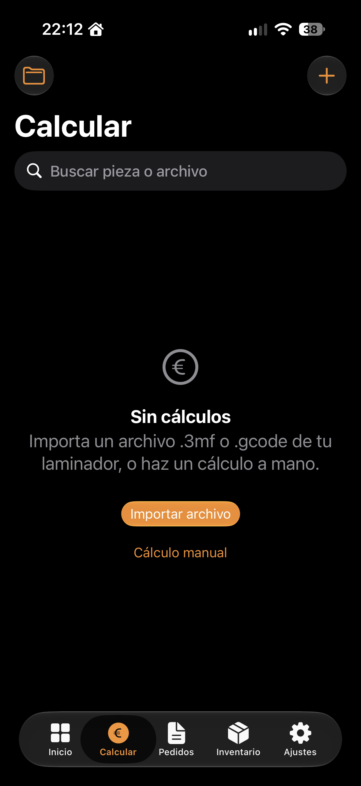
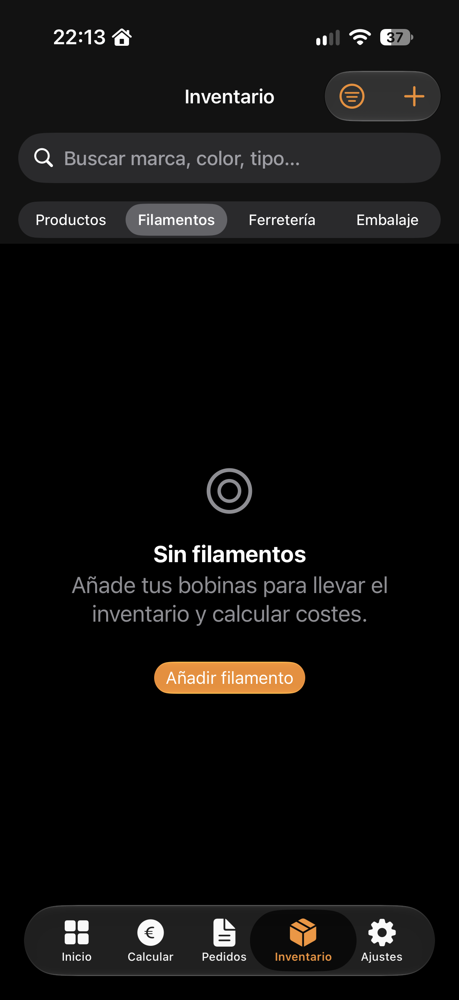

# I3D

**Calcula, organiza y vende tus impresiones 3D desde el iPhone o el iPad.**

I3D es una app para llevar un estudio de impresión 3D: calcula el precio de
cada pieza a partir del archivo del laminador, lleva el inventario, gestiona
clientes, pedidos, cobros y la cola de impresión, y publica catálogos con hoja
de pedido.

Sin cuentas, sin servidores propios, sin publicidad y sin analíticas.

<!-- capturas:inicio -->
<p align="center">     </p>
<!-- capturas:fin -->

## Qué hace

| | |
|---|---|
| **Calcular** | Importa el `.gcode.3mf`, `.3mf` o `.gcode` de Bambu Studio, OrcaSlicer, PrusaSlicer o Cura. Coste real de material, luz, desgaste, fallos, mano de obra, embalaje y gastos fijos. Precio con niveles, redondeo, mínimo por pieza y precios por volumen. Productos de varias placas, cada pieza con sus filamentos. |
| **Inventario** | Filamentos por marca, tipo, acabado y color, con avisos de stock. Productos con fotos, vídeos y enlace al modelo (MakerWorld, Printables…). Ferretería y embalaje con proveedores. |
| **Pedidos y clientes** | Presupuestos, albaranes y proformas en PDF con tu logo. Clientes como CRM, con aviso de duplicados. Pedido desde un mensaje o una captura. Señales, pagos y recordatorios. Envíos con número de seguimiento y fotos del pedido terminado. |
| **Producción** | Cola de impresión con horarios por impresora y aviso al terminar. Plan para agrupar colores y gastar menos filamento. |
| **Vender** | Catálogos en PDF, imagen para redes y página web gratis (GitHub Pages) con hoja de pedido: el cliente elige productos de varios catálogos y te manda el pedido por WhatsApp, Instagram o email. Publicaciones para Instagram y TikTok. |
| **Números** | Estadísticas de ventas, gastos fijos, resumen por mes, trimestre y año, y punto de equilibrio. |

También: varios estudios en la misma app, datos compartidos entre dos personas
con una carpeta de iCloud Drive (los cambios de los dos se unen sin duplicar) y
diseño Liquid Glass en iOS 26.

## Cómo instalarla (gratis)

I3D no está en el App Store. Se instala con **SideStore**, que es gratuito y
firma la app con tu propio Apple ID (puedes usar uno secundario).

1. Instala SideStore siguiendo su guía oficial (la primera vez necesitas un
   ordenador, solo una vez).
2. En SideStore: pestaña **Fuentes** › **+** › pega esta dirección:

   ```
   https://raw.githubusercontent.com/Atypicapp/I3D/main/fuente.json
   ```

3. Abre la fuente I3D e instala la app.
4. Ábrela: un asistente te ayuda a dejarla lista en un minuto.

**Con otras herramientas (AltStore, AirSign, Sideloadly…):** usa esta
dirección, que siempre descarga la última versión:

```
https://github.com/Atypicapp/I3D/releases/latest/download/I3D.ipa
```

Requisitos: iPhone o iPad con iOS 17 o posterior.

## Actualizaciones

Cuando hay una versión nueva, SideStore la muestra en **Mis apps**. Pulsa
**Actualizar** (con LocalDevVPN conectado).

**No borres la app para actualizar**: actualizar encima conserva tus datos;
borrarla los borra (salvo que uses una carpeta de iCloud Drive).

Con un Apple ID gratuito las apps caducan a los 7 días si SideStore no las
renueva: ábrelo de vez en cuando o activa la renovación automática.

## Preguntas frecuentes

**¿Es gratis?** Sí. Sin suscripciones ni compras dentro de la app.

**¿Dónde están mis datos?** En tu iPhone o iPad. Si eliges una carpeta de
iCloud Drive para compartirlos, también ahí, en tu cuenta. Nadie más los recibe.

**¿Podemos usarla dos personas?** Sí: elegid la misma carpeta compartida de
iCloud Drive en Ajustes › Datos. Si los dos cambiáis algo a la vez, la app une
los cambios.

**¿Hace facturas?** Hace presupuestos, albaranes y facturas proforma. La
factura legal debe hacerse con un programa homologado.

**¿Funciona en Mac?** En Mac con Apple Silicon se puede instalar la versión de
iPad con herramientas como SideStore o AltStore.

## Privacidad

Resumen: sin cuentas, sin servidores propios, sin publicidad ni analíticas. Lee
la [política de privacidad completa](PRIVACIDAD.md). También está dentro de la
app (Ajustes › Acerca de I3D).

## Sugerencias y errores

Abre un [issue](https://github.com/Atypicapp/I3D/issues) contando qué pasa y,
si puedes, con una captura (sin datos de clientes).

---

## Para el autor

**Publicar una versión nueva**

1. En Xcode, sube la **Version** y saca el `.ipa` (Product › Build).
2. Aquí en GitHub: **Releases** › **Draft a new release**.
3. **Tag**: `v` + la versión, por ejemplo `v0.10.0` (Create new tag).
4. Título libre y, en la descripción, las novedades (salen en SideStore; los
   símbolos de Markdown se quitan solos).
5. Arrastra el archivo `I3D.ipa` y pulsa **Publish release**.

**Capturas e imágenes**

- **Capturas**: súbelas a la carpeta [`capturas`](capturas) (Add file ›
  Upload files). Se ordenan por nombre (`1-inicio.png`, `2-calcular.png`…) y
  aparecen solas en SideStore y en esta página. Para quitar una, bórrala.
- **Cabecera** de la fuente: `imagenes/cabecera.png` (1500×500).
- **Noticias**: la imagen de cada noticia es `imagenes/<identificador>.png`.

En un minuto `fuente.json` (y esta página) se actualizan solos (pestaña
**Actions**).
